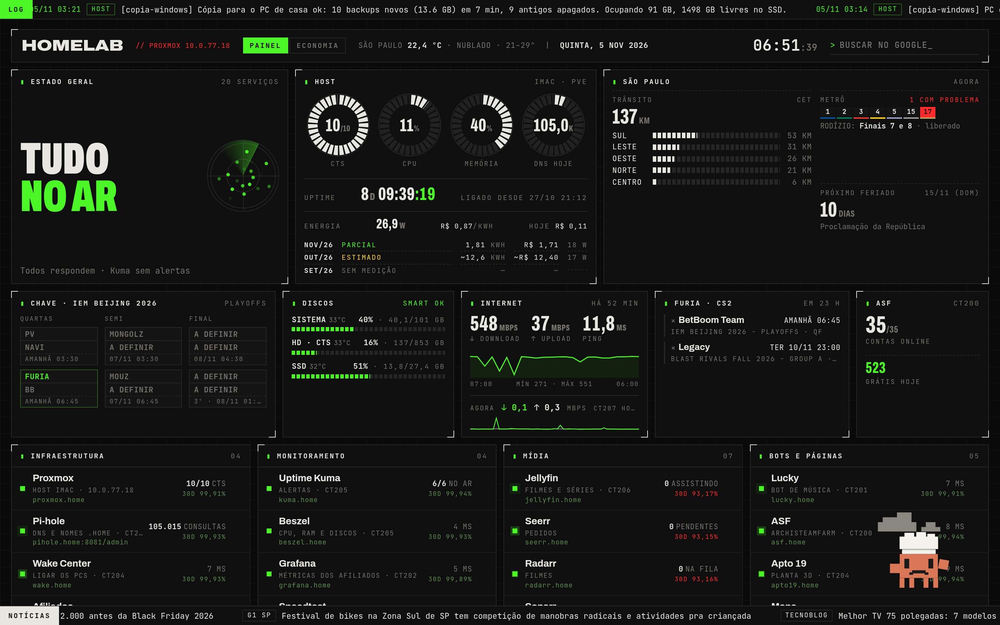
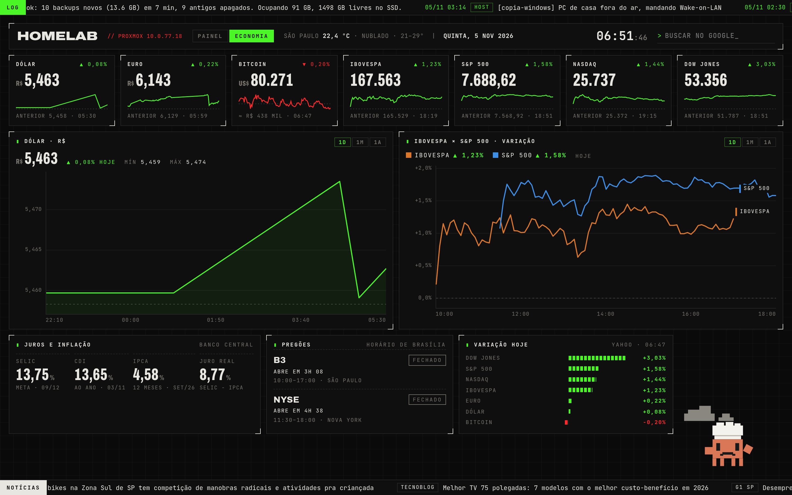
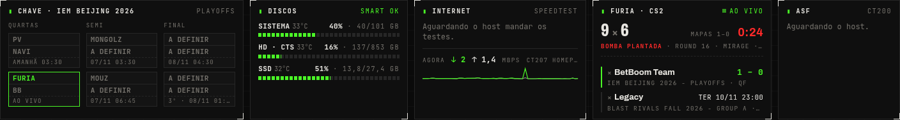
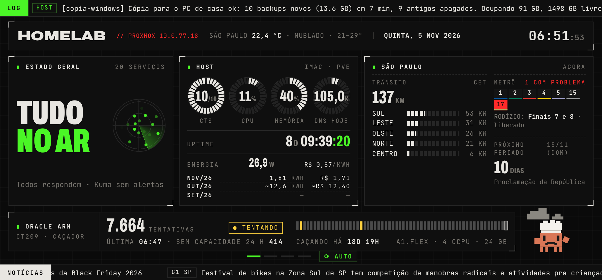
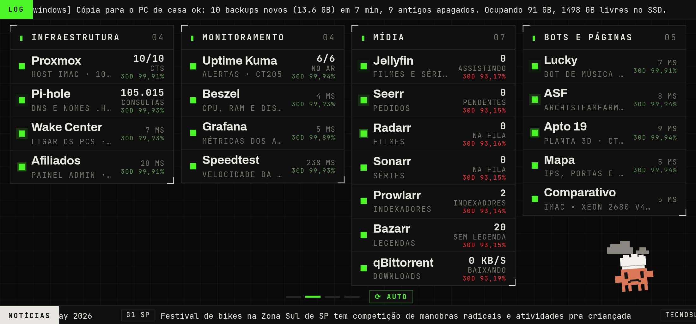
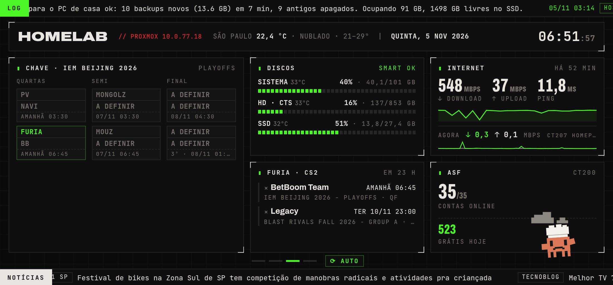
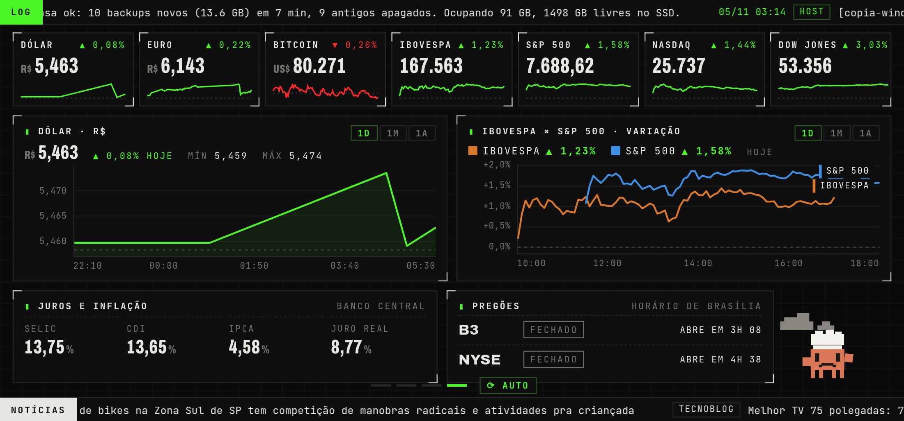

# Homelab Proxmox

Servidor doméstico que eu projetei e opero: um iMac 2017 rodando Proxmox VE com 10 containers LXC,
DNS próprio, proxy reverso com HTTPS interno, monitoramento com alertas no Discord, backup fora do
servidor e um painel de telemetria feito do zero.

> Projetado e operado por mim. O Claude Code (IA) me ajuda nas investigações de problemas e na
> manutenção do servidor.

Mais imagens do painel

| Aba Economia | Linha do meio com a FURIA ao vivo (simulação) |
|---|---|
|  |  |

**iPhone deitado:** carrossel de 4 telas, sem rolagem

| | |
|---|---|
|  |  |
|  |  |

## Em números
| | |
|---|---|
| Hardware | iMac 2017 · i5-7360U 2c/4t · 16 GB · HDD 1 TB + SSD |
| Virtualização | Proxmox VE 9 · 10 containers LXC (Debian 13) · Docker Compose dentro dos CTs |
| Rede | 10.0.77.0/24 · AirPort Extreme como roteador · modem em bridge |
| Acesso externo | só Tailscale (subnet router + exit node) — **nenhuma porta aberta no roteador** |
| Consumo | ~20 W medidos pelo sensor da própria Apple (SMC) |

## O que roda
| Área | Serviços |
|---|---|
| Infra | Pi-hole (DNS, curinga `*.home`), Caddy (proxy reverso, `tls internal`), Wake-on-LAN |
| Monitoramento | Uptime Kuma, Beszel, Diun, avisos do host no Discord (temperatura, travas, backup, containers) |
| Mídia | Jellyfin + Radarr/Sonarr/Prowlarr/Bazarr/qBittorrent |
| Bots e apps | bots de Discord, plataforma de dados em Python + PostgreSQL + Grafana |
| Painel | página própria "Telemetria" em Python puro (sem framework), servida no `homepage.home` |

## Estudos de caso
1. [O servidor que reiniciava sozinho toda semana](docs/casos/01-reboots-watchdog.md) — de "falta de luz" a watchdog de 60 s por travamento de disco
2. [Trocando a rede inteira de faixa sem derrubar nada](docs/casos/02-rede-10077.md) — AirPort como roteador, modem em bridge, fim do NAT duplo
3. [Um painel de telemetria do zero](docs/casos/03-painel-telemetria.md) — energia pelo SMC da Apple, Tarifa Branca, iPhone e widget
4. [Container .NET que achava ter 16 GB](docs/casos/04-oom-dotnet.md) — OOM dentro de LXC e por que o Docker dizia que estava tudo bem
5. [Placar da FURIA no painel: escolhendo fontes de dados](docs/casos/05-furia-fontes.md) — Liquipedia, APIs pagas, robots.txt e limites de uso

## Documentação
- [Arquitetura](docs/arquitetura.md)
- [Decisões e regras da casa](docs/decisoes.md)
- [Scripts](scripts/README.md)

## Regras que eu sigo
- Nenhuma porta aberta para a internet; acesso de fora só pela VPN.
- A solução mais simples que resolve: sem Kubernetes, sem microserviços.
- Toda mudança é registrada com data; antes de editar, backup do arquivo e diff.
- Backup diário fora do servidor, com teste de restauração.
