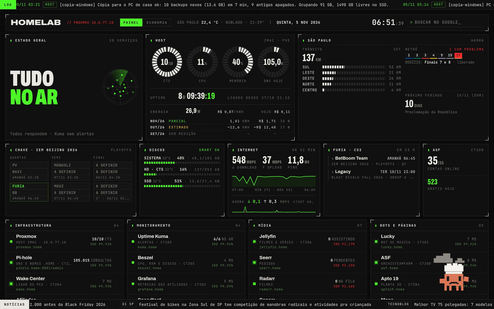
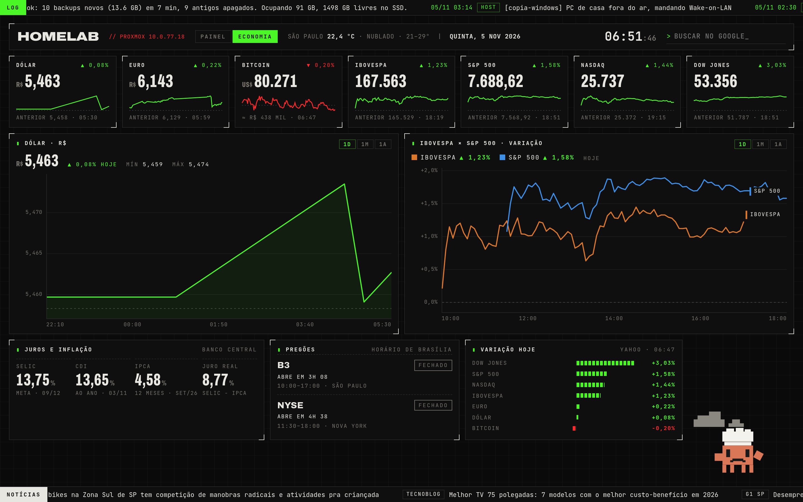
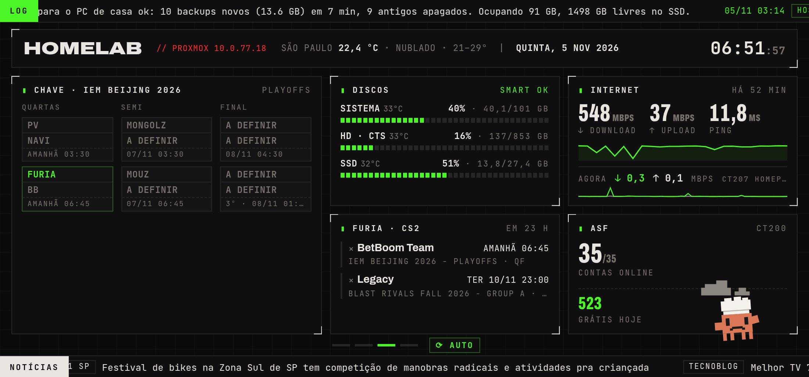

# Um painel de telemetria do zero

**Resumo:** troquei um dashboard pronto por uma página própria: um servidor em Python puro
(biblioteca padrão, sem framework) que junta tudo do lado do servidor e entrega um JSON único
para uma página HTML.

| Aba Economia | iPhone deitado (tela 3) |
|---|---|
|  |  |

## Como funciona
- Cada coleta roda numa thread no seu próprio ritmo (serviços a cada 30 s, discos 5 min, notícias 15 min…)
  e guarda o **último dado bom**: se uma fonte cai, o painel mostra o anterior marcado como fora do ar.
- Credenciais ficam só no servidor; o navegador nunca recebe senha ou token.
- Dados que moram dentro de outros containers são lidos pelo host e enviados por POST a cada 2 min.
- Serviço só fica vermelho depois de 2 falhas seguidas; durante o backup da madrugada, a falha vira
  amarela com o motivo ("em backup").

## Destaques
- **Energia de verdade:** a potência vem do sensor `PDTR` do SMC da Apple; o custo usa a **Tarifa Branca**
  da distribuidora (valores e bandeira tarifária puxados dos dados abertos da ANEEL, com impostos).
- **São Paulo:** trânsito por região (CET), status das linhas do metrô, rodízio do dia e próximo feriado.
- **Economia:** dólar, euro, bitcoin, bolsas e indicadores do Banco Central, com gráficos de 1 dia a 1 ano.
- **iPhone:** instalável como app; deitado vira um carrossel de 4 telas sem rolagem; widget no Scriptable.
- **Mascote:** um personagem de pixels que muda de roupa conforme o clima e fica sincronizado entre
  todos os aparelhos pelo relógio do servidor.

## Decisões
- Sem framework e sem build: um arquivo Python e um HTML. Fácil de entender e de restaurar.
- Testes visuais com Playwright rodando no host, injetando dados reais ou simulados na página.

## O que aprendi
<!-- TODO -->
